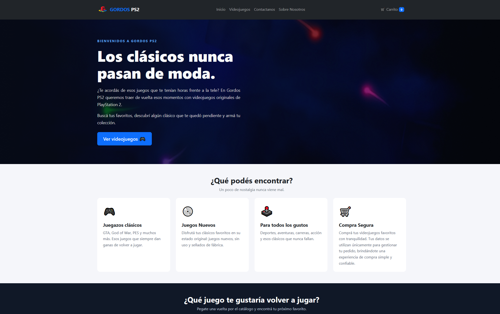
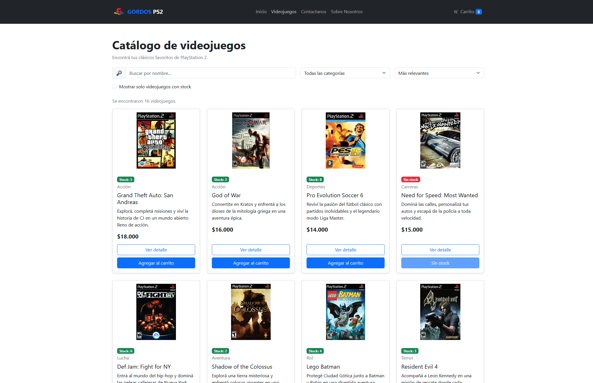
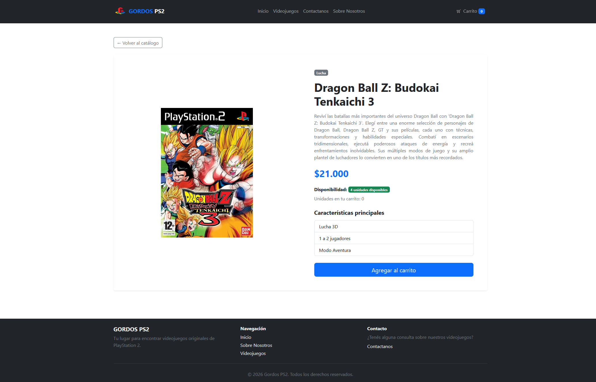
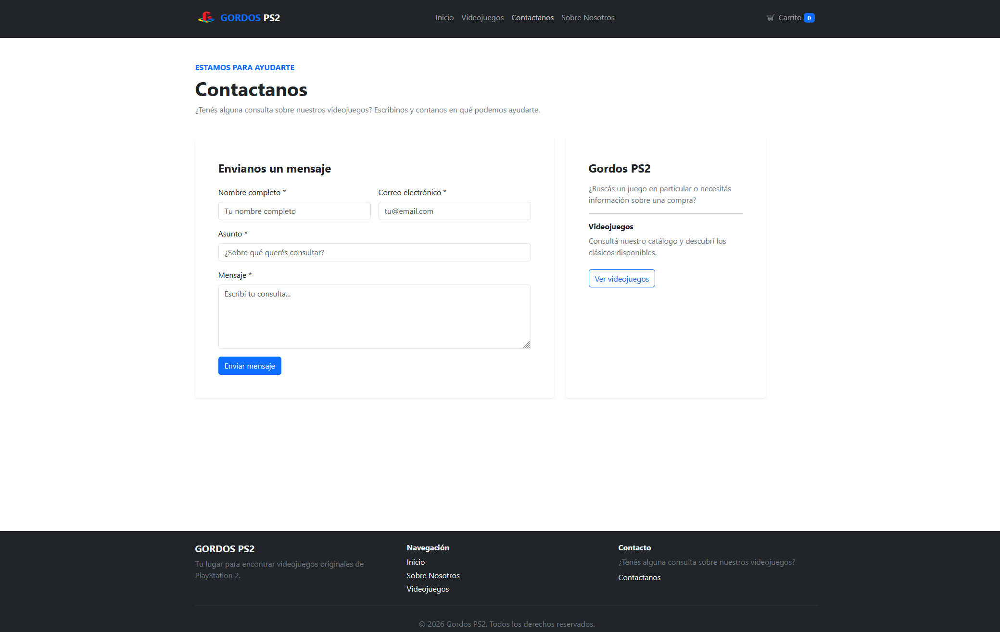
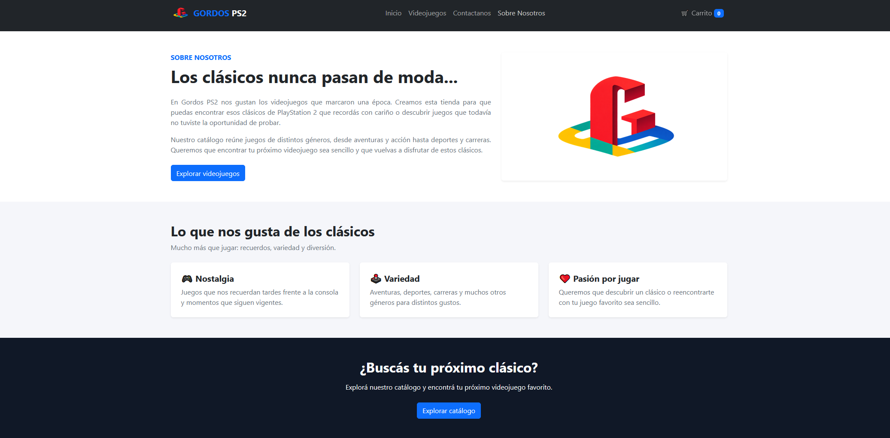
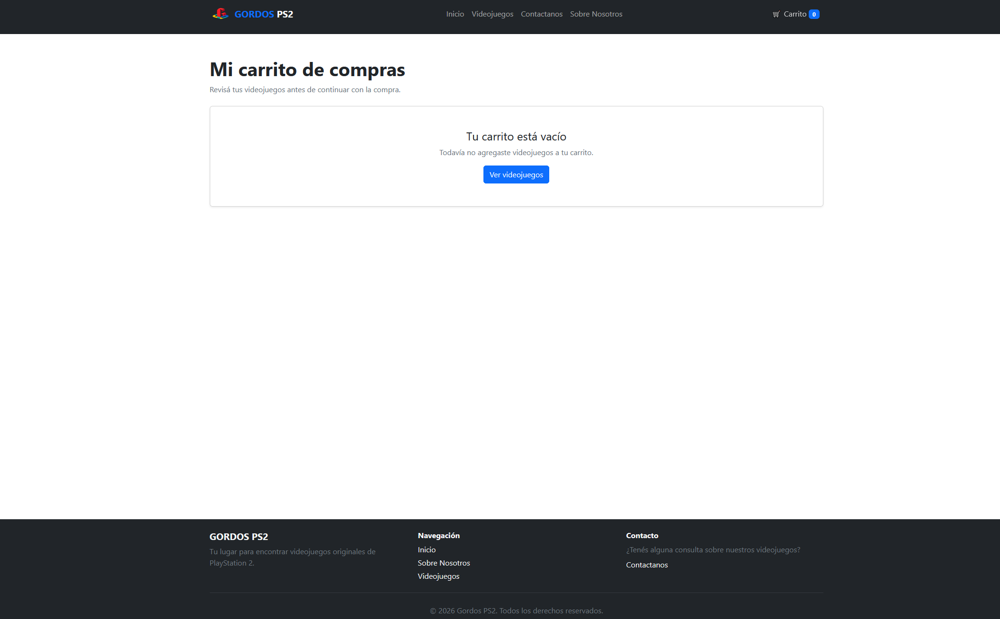
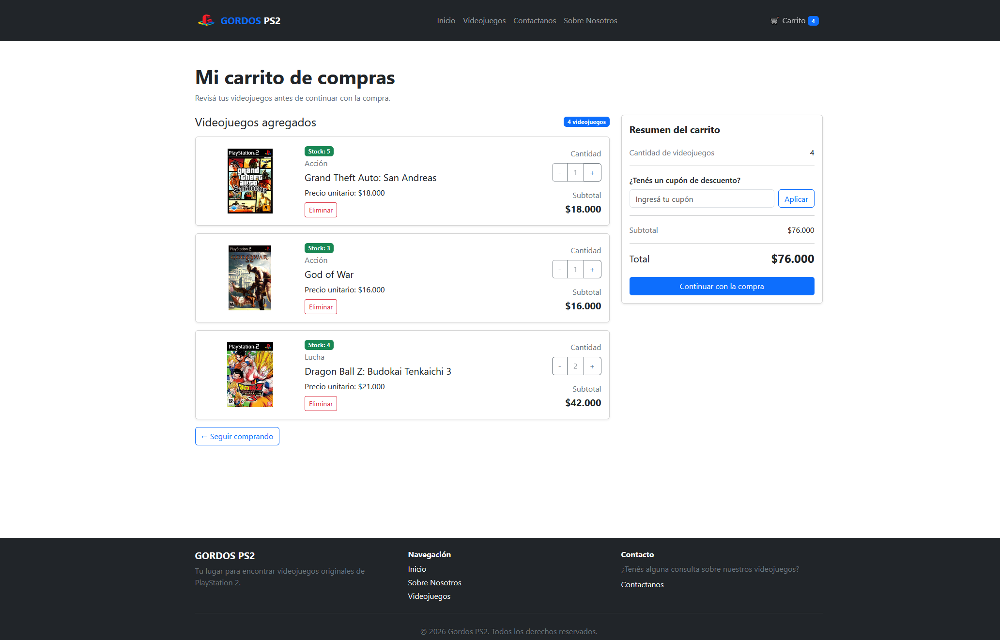
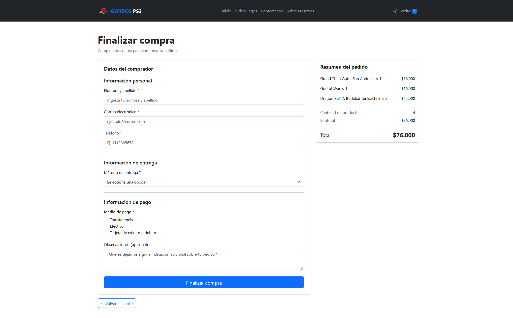
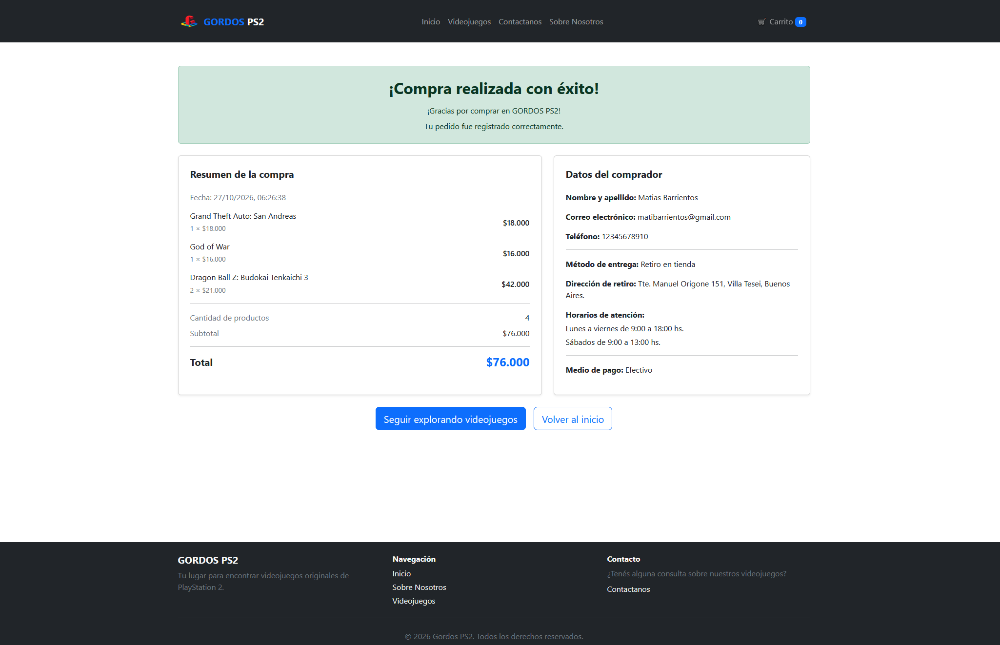

# Gordos PS2

## Descripción del proyecto

Gordos PS2 es una tienda online desarrollada como trabajo práctico. El sitio permite a los usuarios explorar productos relacionados con PlayStation 2, consultar sus detalles y acceder al proceso de finalización de compra.

El proyecto cuenta con distintas secciones que permiten conocer la tienda, navegar por los productos y comunicarse con el equipo.

## Tecnologías utilizadas

- **React:** desarrollo de la interfaz de usuario mediante componentes.
- **Vite:** herramienta para ejecutar y construir el proyecto.
- **JavaScript:** lenguaje utilizado para la lógica de la aplicación.
- **HTML5:** estructura del sitio.
- **CSS3:** estilos y diseño visual.
- **Bootstrap:** diseño y estilos de los componentes.
- **React Router:** navegación entre las distintas páginas.

## Funcionalidades

- Visualización del catálogo de productos.
- Acceso al detalle de cada producto.
- Sección de finalización de compra.
- Página de contacto.
- Página «Sobre nosotros».
- Navegación entre las distintas secciones del sitio.

## Instalación y ejecución

Para ejecutar el proyecto localmente, es necesario tener instalado **Node.js** y **npm**.

### 1. Clonar el repositorio

```bash
git clone https://github.com/santiago-elias-bravo/gordosPS2.git
```

### 2. Ingresar a la carpeta del proyecto

```bash
cd gordosPS2
```

### 3. Instalar las dependencias

```bash
npm install
```

### 4. Ejecutar el proyecto

```bash
npm run dev
```

Una vez iniciado, Vite mostrará en la terminal la dirección local para acceder al sitio desde el navegador. Generalmente es:

```text
http://localhost:5173
```


## Integrantes del grupo

- Matías Barrientos (44183188) — matias.barrientos2805@gmail.com
- Santiago Elias Bravo (42502007) — santiagoeliasbravo@gmail.com
- Lucas Valentin Telleria (45825839) — valentintelleria90@gmail.com

## Capturas de pantalla

### Página de inicio



### Catálogo de videojuegos



### Detalle de videojuego



### Contactanos



### Sobre Nostros



### Carrito de compras vacío



### Carritos de compras con videojuegos



### Formulario de compra



### Confirmación de compra

